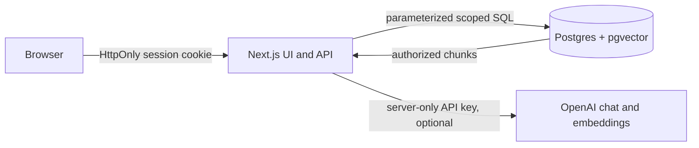

# Architecture

## Runtime

One Next.js App Router process serves the browser UI and JSON route handlers. PostgreSQL stores users, sessions, policies, chunks, conversations, checklists, requests, feedback, and audit data. The Compose database image includes pgvector. Local development uses Next.js hot reload; Compose builds a Node production image and starts the app only after the database health check passes.

## Request flows

- **Sign in:** email is normalized, password is verified using `scrypt`, and a random session token is stored by SHA-256 hash. The browser receives only the opaque token in an HttpOnly, SameSite cookie. Each request checks session expiry and account activity.
- **Chat:** require an active user, validate and limit the question, check conversation ownership, save the user message, then retrieve only current published chunks for the user's organization and audience. No-key mode uses lexical overlap and returns an explicitly simulated answer. Live mode embeds the question, performs a scoped pgvector query, asks the configured model for structured JSON, validates it, rejects citation IDs outside retrieved evidence, and resolves citation metadata from the database. Errors do not silently switch modes.
- **Policy ingestion:** an admin can upload UTF-8 `.txt`/`.md` up to the byte limit. The server reads content into memory, hashes it, assigns a version label, records audience/effective dates, creates database document/chunk records and shows a short preview. It is not retrievable until admin publication. Admins can archive published versions while retaining their records. Live mode requests embeddings; no-key mode exposes lexical search as the mode. Uploads are not served as static files.
- **Request:** owner saves a draft or submits after browser confirmation. Submission creates a request event and audit event in the same DB transaction. HR/admin status transitions use an allowlist and locked row; each transition records the actor and before/after state.

## Authorization model

The session resolves user ID, role, and organization on the server. The browser never supplies an authoritative user, role, or organization value. Employee conversations, checklists, and requests are owner-scoped in their SQL queries. HR/admin inbox reads are organization-scoped. Admin-only routes enforce role checks server-side. Policy visibility is filtered by organization, publication status, effective dates, and audience before retrieval.

## Data model

`db/schema.sql` is the idempotent initial schema. It includes organizations, users, sessions, documents, chunks, conversations, messages, message citations, checklists, HR requests, request events, audit events, and feedback. Vector storage currently uses 1,536 dimensions and records the embedding model per chunk to avoid comparing incompatible model spaces. Changing models requires re-embedding. Migrations are currently applied from the schema file rather than tracked incremental migration versions; production rollout needs a migration ledger and reversible migration strategy.

## API surface

`GET /api/health`, `/api/me`, `/api/documents`, `/api/documents/:id`, `/api/conversations`, `/api/conversations/:id`, `/api/requests`, `/api/checklists`; `POST /api/auth/login`, `/api/auth/logout`, `/api/chat`, `/api/documents`, `/api/documents/:id/ingest`, `/api/documents/:id/publish`, `/api/documents/:id/archive`, `/api/requests`, `/api/requests/:id` (PATCH), `/api/checklists`, `/api/feedback`; `GET /api/admin/evaluation`. Every protected route resolves the session independently. JSON handlers cap bodies and validate schemas; errors return safe codes/messages.

## Failure behavior

Database readiness returns `503` without exposing connection details. Provider failures yield a generic safe chat/upload error; they do not claim a model call succeeded or use a simulated answer as a fallback. Missing evidence produces explicit abstention guidance. Uploaded file parse errors are returned as safe validation errors. Additional production hardening should add structured redacted logs, request tracing, durable rate limits, a richer ingestion job lifecycle, and external backup/restore rehearsal.
